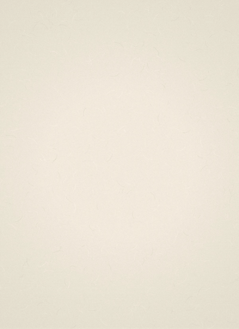
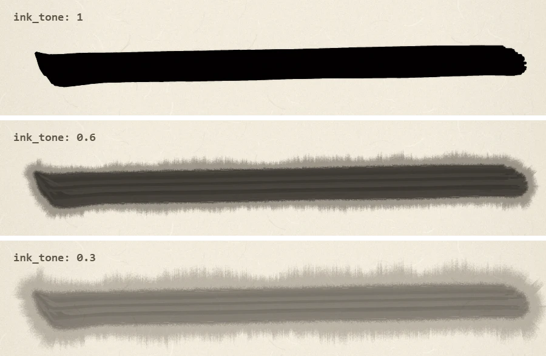
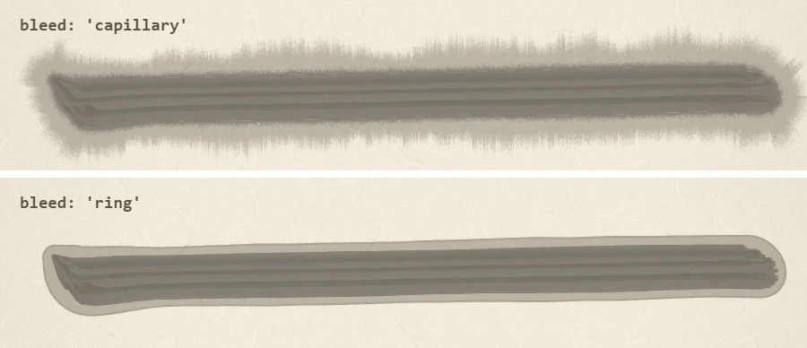
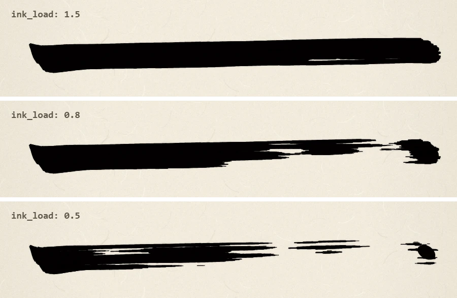
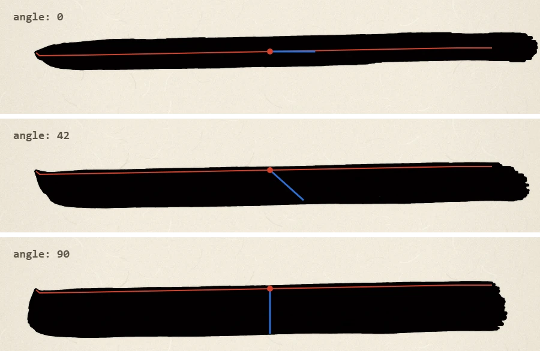
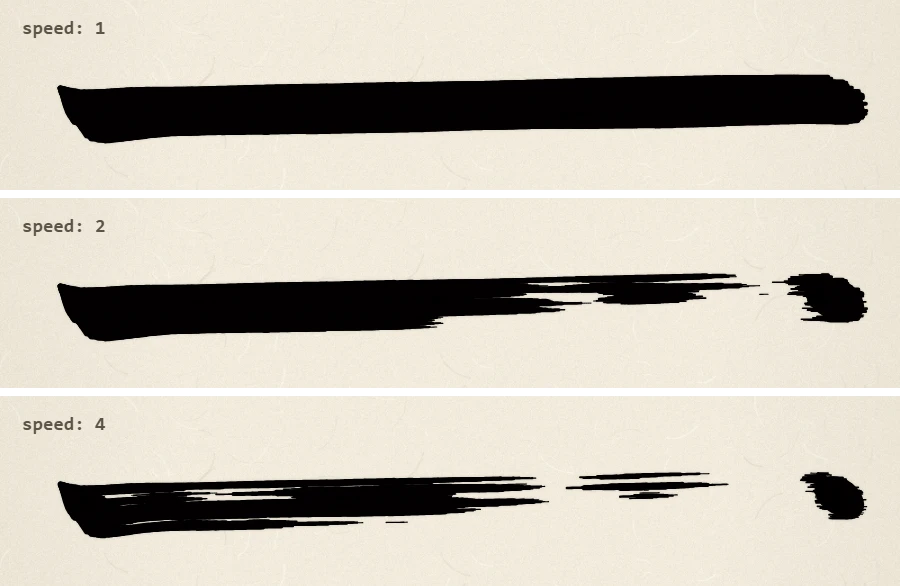
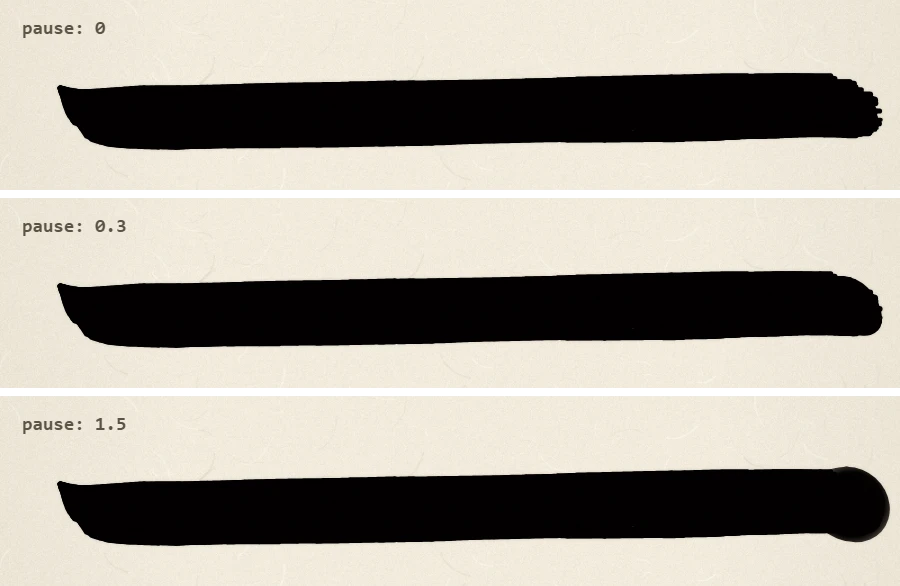

# sho.js

ブラウザで毛筆の書を描く JavaScript ライブラリです。筆の動きを点の列で渡すと、1画ずつ紙に書いていきます。

[English](README.md) · [デモ](https://enpts.github.io/sho/examples/demo.html)



- 点ごとに位置・筆圧・筆の角度・速さ・溜めを指定して書きます。はねや払いといった技法も、専用の命令ではなく点の置き方で表現します。
- 描画側では筆と墨の物理を計算します。毛を1本ずつ動かし、墨が減ってかすれる様子、止めた所に墨が溜まる様子、淡墨のにじみを再現します。
- LLM の出力をそのまま流し込めます。1行届くたびに筆が動きます。参考のシステムプロンプトは [prompt.md](prompt.md) に用意しました（[AI書道コンクール](https://aishodo.enpitsu.org)で使用しているものと同一です）。
- 乱数シードは点の座標から決まるので、同じデータと設定なら、毎回同じ結果が再現されます。アニメーションでも即時描画でも仕上がりは変わりません。
- 依存ライブラリはありません。必要なのはスクリプトと紙の画像だけです。

## インストール

- `sho.js` と `paper.webp` を同じフォルダに置き、スクリプトを読み込むと、グローバル変数 `Sho` が使えます。
- npm パッケージと ES モジュール版は今のところありません。

```html
<script src="sho.js"></script>
```

## 使い方

```html
<canvas id="paper" style="height: 90vh"></canvas>
<script src="sho.js"></script>
<script>
  const engine = new Sho.Engine(document.getElementById('paper'), { pxPerUnit: 1 });

  engine.enqueue([
    { t: 'brush', size: 58 },
    { c: '一' },
    { p: [[205, 676, 0.1, null, 0.5], [211, 681, 1.16, null, 0.4], [287, 680, 1], [680, 647, 1], [730, 647, 1.24, null, 0.3, 0.15], [726, 643, 0.8, null, 0.4]] },
  ]);
</script>
```

canvas の解像度はライブラリ側で設定するので、表示サイズだけを CSS で指定してください。

## 基本

### 紙

紙の大きさは既定で幅 1000 × 高さ 1376 です。左上が原点 (0, 0)、y 軸は下向きで、座標はすべてこの紙の上の値で指定します。

大きさは、オプションの `width` と `height`、または `setPaper()` で変更できます。canvas の解像度は「紙の大きさ × `pxPerUnit`」です。紙の画像は縦横比を保ったまま紙いっぱいに広げ、はみ出た部分は切り落とします。なお、[prompt.md](prompt.md) は既定の大きさを前提にしているので、別の大きさの紙に LLM で書かせるときはプロンプトも書き換えてください。

### 点

1つの画は `{"p": [点, ...]}` と書き、各点は次の形式の配列です。

```
[x, y, 筆圧, 角度, 速さ, 溜め]
```

| 値 | 意味 | 省略時 |
| --- | --- | --- |
| `x`, `y` | 穂先が紙に触れる位置 | 省略不可 |
| 筆圧 | 0〜2。1 のとき、線の幅が筆の太さと同じになる | 前後の点から補間（1つも指定がなければ 1） |
| 角度 | 穂先から見た腹の向き（度）。0 が右、90 が下、180 が左、270 が上。短いほうの向きへ回る | 直前の点の角度（最初の点は既定の角度） |
| 速さ | 筆を動かす速さの倍率（0.05〜6）。速いほどかすれる | 前後の点から補間（1つも指定がなければ 1） |
| 溜め | その点で筆を止める秒数。墨が溜まり、輪郭が丸くなる | 0 |

途中の値を飛ばすには `null` を入れます。後ろの値は書かなくてもかまいません。点の中に `"k"` を入れると、そこで線が折れて角になります（例: `[467, 487, 1.44, null, 0.3, 0.14, "k"]`）。オブジェクト形式 `{x, y, p, a, v, d, k}` でも書けます。

### 墨

書き進めるほど墨が減るので、同じ字の後のほうの画や、筆を速く動かした所がかすれます。`ink_load` で筆に含ませる墨の量を、`ink_tone` で墨の濃さを指定します。

筆に墨をつける時は、オプションの `autoDip` で決めます。水墨画のように `{"c":…}` のないデータでは、`'char'` だと墨をつけないので、`'stroke'` か `'dry'` を使います。

| `autoDip` | 筆に墨をつける時 |
| --- | --- |
| `true` または `'char'`（既定） | `{"c":…}` のたび |
| `'stroke'` | 画を書く前に毎回 |
| `'dry'` | 画を書く前に、墨が切れかけていたら。画の途中で切れたときは、そのままかすれて最後まで書く |
| `false` | つけない。`{"dip":…}` で好きな所でつけられる |

`'char'` と `'stroke'` では、`autoDipEvery` で何字・何画ごとにつけるかを指定できます。最初の字・画から数えるので、`2` なら 1、3、5 番目…の字や画でつけます。

```js
const engine = new Sho.Engine(canvas, { autoDip: 'stroke', autoDipEvery: 2 });
```

## 表現の例

どの画像も、太さ 58 の筆で次の横画を書き、条件を1つだけ変えて比べたものです。

```json
{"p":[[60,88,0.1,null,0.5],[66,93,1.1,null,0.4],[140,92,1,null,1],[760,80,1,null,1],[820,80,1,null,0.4]]}
```

### 墨の濃さ

筆の宣言の `ink_tone` で指定します。薄い墨ほど水分が多いので、紙の繊維を伝うように、線の外へ放射状ににじみます。紙に移る墨が多い所ほど広くにじみ、濃墨はにじみません。この例の速さは 0.6 です。



### にじみ方

淡墨のにじみ方は、オプションの `bleed` で選べます。濃墨はにじまないので、どちらでも同じ見た目です。

- **`'capillary'`（既定）:** 墨が繊維状に外へ広がり、外の縁はぎざぎざにぼやけます。筆の通った跡の輪郭もぼやけます。にじみは画を書き終えてから現れます。描画には `'ring'` より時間がかかります。
- **`'ring'`:** 輪郭のなめらかな帯で、外の縁に少し濃い水際が残ります。筆が遅い所ほど広がり、筆の動きに合わせて現れます。

この例は `ink_tone` 0.3、速さ 0.6 です。



### 墨の量

筆の宣言の `ink_load` で指定します。色は変わらず、墨が切れはじめる位置が変わります。この例の速さは 1.5 です。



### 筆の角度（穂先と腹）

指定した点は穂先の位置で、腹はそこから角度の向きに広がります。画像の赤い線が穂先の通り道、青い線が穂先から腹までを示しています。青い線の長さは「筆圧 × 筆の太さ」で、この例では 1.3 × 58 です。

- **0**: 筆の軸が進行方向と揃うので、線はいちばん細くなります。穂先は線の中央を通ります。
- **42（既定）**: 穂先が線の上端を通り、腹は右下に来ます。
- **90**: 筆の軸が進行方向と直交するので、線はいちばん太くなります。



### かすれ

筆が速いほど紙に移る墨が減り、線が進行方向に沿って筋状に途切れます。かすれは一様ではなく、強く出る所と弱い所がまとまって現れます。この例では中央の2点の速さを変えています。線の終わりは筆が遅くなるので、墨がまた濃く乗ります。



### 溜め

溜めを指定した点では筆が止まり、墨が溜まって線の端の荒れが丸くなります。長く止めるほど膨らみ、縁のやわらかい玉のようになります。この例では最後の点に指定していて、筆圧は 1.3 です。



## LLM に書かせる

[prompt.md](prompt.md) をシステムプロンプトにして書いてほしい言葉を送り、返ってきたテキストを `StreamParser` に渡します。行が完成するたびにエンジンへ送られます。

```js
const engine = new Sho.Engine(canvas, { pxPerUnit: 1 });
const parser = new Sho.StreamParser((cmd) => engine.enqueue(cmd));

for await (const text of yourModelStream) parser.feed(text);
parser.end();
```

生成済みのテキストなら `Sho.parseDocument(text)` でコマンドの配列に変換できます。JSON Lines と JSON 配列のどちらでも読み込めます。

## コマンド

| コマンド | 説明 |
| --- | --- |
| `{"t":"brush","size":58,"ink_tone":1,"ink_load":1}` | 筆の宣言。宣言のたびに筆に墨をつける。次の宣言まで有効で、いつでも筆を持ち替えられる。指定できる値は下の表のとおり |
| `{"c":"永"}` | 1字の書き始め。`autoDip` が `true` か `'char'` のとき、ここで筆に墨をつける（`autoDipEvery` の間隔に従う） |
| `{"p":[...]}` | 1画を書く |
| `{"t":"sign","text":"名前","dir":"v"}` | 左下に署名を入れる（60 文字まで）。`dir` は `"v"`（縦書き、既定）か `"h"`（横書き） |
| `{"comment":"..."}` | 何も描かない。内容は `command` イベントで受け取れる |
| `{"dip":0.4}` または `{"t":"dip"}` | 筆に墨をつける。量に上限はなく、指定しなければ今の `ink_load` の量 |
| `{"t":"wait","ms":300}` | アニメーションの途中で待つ。`ms` の既定は 300 |

筆の宣言の値はすべて省略でき、省略した値は今の設定のままです。最初の設定は、表の右端のオプションの値です。

| 値 | 範囲 | 意味 | オプション |
| --- | --- | --- | --- |
| `size` | 0 より大きい値 | 筆圧 1 のときの線の幅 | `brushSize` |
| `ink_tone` | 0.05〜1 | 墨の濃さ | `inkTone` |
| `ink_load` | 0.1〜1.5 | 墨の量 | `inkLoad` |
| `ink_rate` | 0〜4 | 墨の減りやすさ。`0` で減らない | `inkRate` |
| `bristles` | 20〜1000 | 太さ 60 の筆の毛の本数 | `bristles` |
| `a` | 任意の角度（度） | 筆の角度の既定値 | `angle` |

`ink_tone`、`ink_load`、`ink_rate`、`bristles` は、範囲外の値は、近いほうの端の値になります。

## API

### `new Sho.Engine(canvas, options)`

| オプション | 既定値 | 説明 |
| --- | --- | --- |
| `pxPerUnit` | `1` | 紙の 1 単位あたりの canvas のピクセル数。大きいほど精細になるが、描画は遅くなる |
| `paperColor` | `'#f2ebdc'` | 無地の紙の色。`paper` が `null` のときと、画像を読み込むまでの間や読み込めないときに使う |
| `width`, `height` | `1000`, `1376` | 紙の大きさ |
| `paper` | `'paper.webp'` | 紙の画像の URL（ページからの相対パス）。既定の画像だけは `sho.js` と同じ場所から読む。`null` で無地の紙 |
| `instant` | `false` | アニメーションせずに一度に描く |
| `speed` | `1` | アニメーションの再生速度。`0` で一時停止 |
| `bristles` | `300` | 太さ 60 の筆の毛の本数。実際の本数は筆の太さに比例し（20〜1000 本）、描画時間も本数に応じて延びる。筆の宣言の `bristles` があればそちらを優先 |
| `brushSize` | `40` | 筆の宣言がないときの太さ |
| `angle` | `42` | 筆の角度の既定値 |
| `inkLoad` | `1` | 墨の量の既定値。筆の宣言の `ink_load` があればそちらを優先 |
| `inkTone` | `1` | 墨の濃さの既定値。筆の宣言の `ink_tone` があればそちらを優先 |
| `inkRate` | `1` | 墨の減りやすさ。筆の宣言の `ink_rate` があればそちらを優先 |
| `autoDip` | `true` | 筆に墨をつける時。`true` か `'char'` で字ごと、`'stroke'` で画ごと（書く前）、`'dry'` で墨が切れかけたとき（画を書く前に判定）、`false` でつけない |
| `autoDipEvery` | `1` | `'char'` と `'stroke'` のとき、何字・何画ごとに墨をつけるか（最初の字・画から数える） |
| `bleed` | `'capillary'` | 淡墨のにじみ方。`'capillary'` は画を書いた後に放射状に広がる。`'ring'` は水際のあるなめらかな帯 |
| `mottle` | `0.5` | かすれの強弱のムラの深さ。`0` でムラなし |
| `mottleSize` | `1` | ムラの大きさ |
| `mottleContrast` | `2.2` | ムラのメリハリ |

| メソッド・プロパティ | 説明 |
| --- | --- |
| `enqueue(command)` | コマンド、またはコマンドの配列を追加する |
| `flush()` | 未処理のコマンドをすぐに全部描く |
| `clear()` | 未処理のコマンドを捨てて紙を白紙に戻し、筆の設定も初期状態に戻す |
| `setPaper(width, height)` | 紙を白紙に戻し、大きさを変更する。筆の設定と未処理のコマンドはそのまま。書いている途中の画は破棄され、筆に墨をつけ直す |
| `toDataURL()` | 絵を PNG の data URL で返す |
| `destroy()` | エンジンを停止する。canvas の絵はそのまま残る |
| `on(event, fn)` | イベントを登録する（下の表を参照） |
| `busy` | 未処理のコマンドや描画中の画があれば `true` |
| `ready` | 紙の画像の読み込みが完了すると解決する Promise（読み込みに失敗した場合も解決する） |

| イベント | 発生するタイミング |
| --- | --- |
| `command` | コマンドの実行開始時。引数はそのコマンド |
| `idle` | アニメーションで、未処理のコマンドをすべて描き終えたとき |

### その他

- `Sho.StreamParser(onCommand, onOtherText)`: `feed(text)` でテキストを渡し、最後に `end()` を呼びます。JSON として読めない行は `onOtherText` に渡されます。1行が JSON の配列なら、配列のまま `onCommand` に渡されます。
- `Sho.parseDocument(text)`: テキストをコマンドの配列に変換します。
- `Sho.ready`: 既定の紙の画像の読み込みが完了すると解決する Promise です。

## 補足

- 紙の画像が見つからなくてもエラーにはならず、無地の紙で描きます。`sho.js` をバンドルすると自身の場所を判定できない場合があるので、`paper` で画像の場所を指定してください。
- 紙を含めた絵を `toDataURL()` で書き出すときは、先に `engine.ready` を待ってください。
- 墨の減り方 `inkRate` の既定値 `1` は、実際の筆に合わせた値ではありません。作者の感覚では `2.5` ぐらいが現実の書道に近いと思います。
- 描画が遅いときは、`bristles` と `pxPerUnit` を下げると軽くなります。淡墨では `bleed` を `'ring'` にしても軽くなります。
- canvas と DOM を使うので、ブラウザ専用です。動作確認は Chrome でのみ行っています。

## デモ

[examples/demo.html](examples/demo.html) では、技法ごとのサンプルの再生や JSON の編集ができ、筆と墨の設定をスライダーで試せます。PNG の保存には HTTP での配信が必要です。それ以外は、ファイルを直接開いても動きます。

[AI書道コンクール](https://aishodo.enpitsu.org)は sho.js を使って運営している企画です。さまざまな LLM に同じ条件で同じ課題を書かせ、その作品を筆の動きごと再生して見られます。

## ライセンス

[MIT License](LICENSE) (c) [enpitsu](https://x.com/enpitsu)
