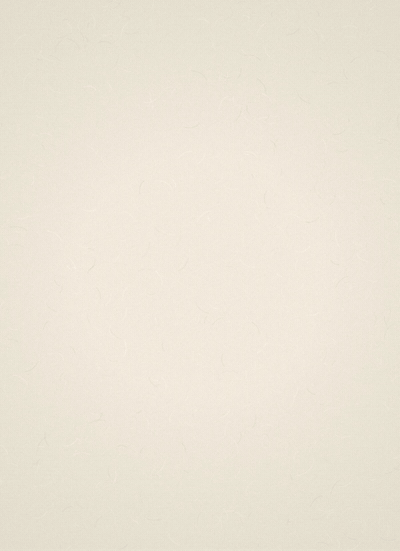
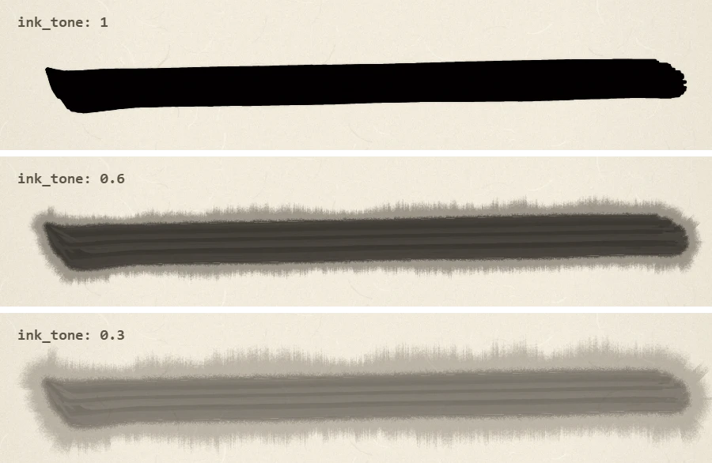
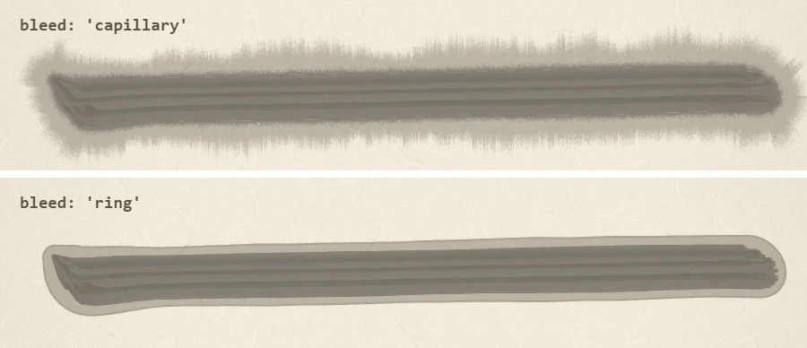
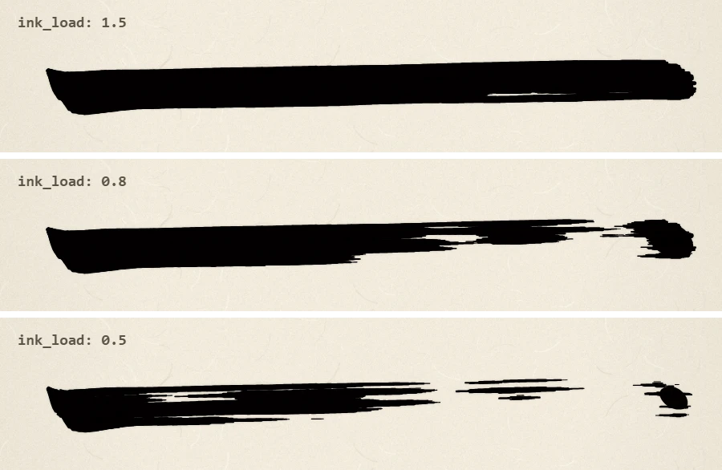
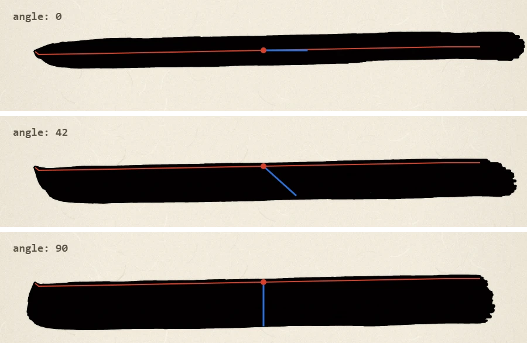
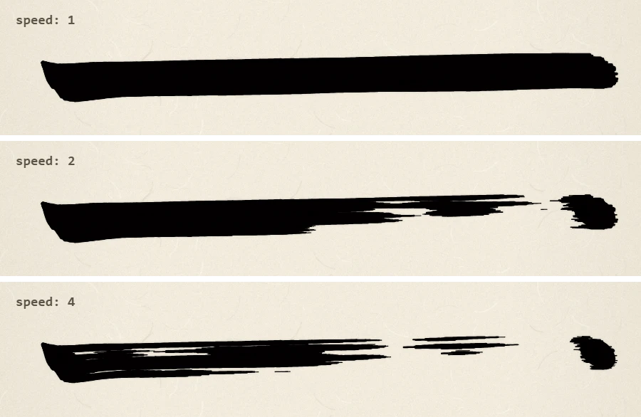
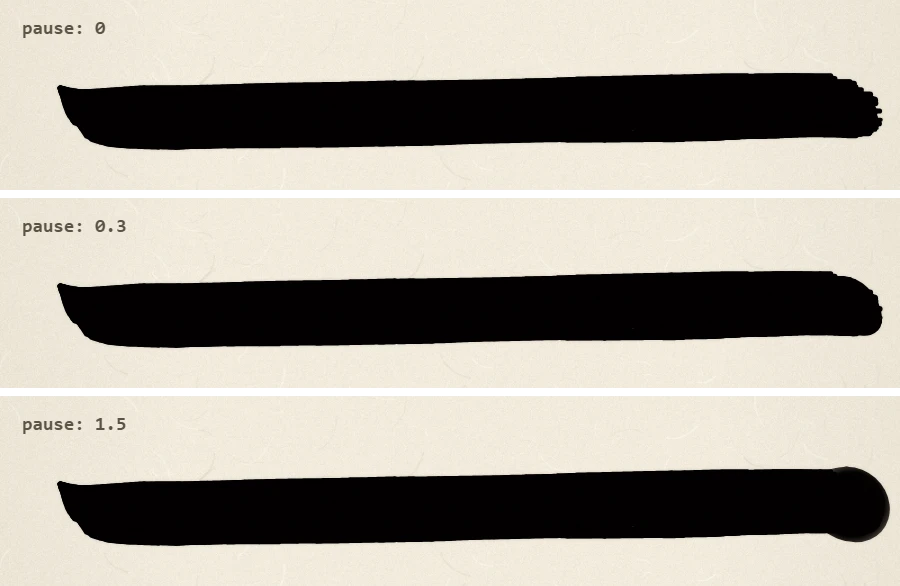

# sho.js

A brush calligraphy engine for the browser. Give it a list of points, and a simulated brush writes them on paper, one stroke at a time.

[日本語](README.ja.md) · [Demo](https://enpts.github.io/sho/examples/demo.html)



- **Each stroke is a list of points.** Each point can set position, pressure, brush angle, speed and pause. Techniques such as hooks and sweeps come from how the points are placed.
- **The engine handles only the physics.** It simulates individual bristles, ink running out, dry-brush streaks, pooling where the brush rests, and bleeding in pale ink.
- **Made for streaming.** Feed it an LLM's output as it arrives, and the brush moves as each line completes. Sample system prompts are included: [prompt.en.md](prompt.en.md) in English, and [prompt.md](prompt.md) in Japanese, the one used by [AI Shodo Arena](https://aishodo.enpitsu.org).
- **Deterministic.** Random seeds are derived from the stroke coordinates, so the same data and settings always produce the same picture, whether animated or drawn instantly.
- **No dependencies.** One script and one paper image.

## Installation

Copy `sho.js` and `paper.webp` into the same folder, then load the script. It defines a global `Sho`. There is no npm package or ES module build yet.

```html
<script src="sho.js"></script>
```

## Quick start

```html
<canvas id="paper" style="height: 90vh"></canvas>
<script src="sho.js"></script>
<script>
  const engine = new Sho.Engine(document.getElementById('paper'), { pxPerUnit: 1 });

  engine.enqueue([
    { t: 'brush', size: 58 },
    { c: '一' },
    { p: [[205, 676, 0.1, null, 0.5], [211, 681, 1.16, null, 0.4], [287, 680, 1], [680, 647, 1], [730, 647, 1.24, null, 0.3, 0.15], [726, 643, 0.8, null, 0.4]] },
  ]);
</script>
```

The engine sets the canvas's pixel size itself. Use CSS to set its display size.

## Core concepts

**Paper.** The paper is 1000 × 1376 units by default, with (0, 0) at the top left and y pointing down. All points use paper coordinates. To change the size, use the `width` and `height` options or `setPaper()`. The canvas resolution is the paper size × `pxPerUnit`. The paper image keeps its proportions, fills the paper and is cropped to fit. The sample system prompts assume the default size, so update them if an LLM will write on other sizes.

**Points.** A stroke is `{"p": [point, ...]}`, and each point is an array:

```
[x, y, pressure, angle, speed, pause]
```

| Value | Meaning | If omitted |
| --- | --- | --- |
| `x`, `y` | Where the brush tip touches the paper | Required |
| `pressure` | 0–2. At 1, the line is as wide as the brush size | Interpolated from nearby points, or 1 |
| `angle` | Degrees from tip to belly: 0 right, 90 down, 180 left, 270 up. The brush turns toward it the shorter way round | Keeps the previous angle (the first point uses the default angle) |
| `speed` | Speed multiplier, limited to 0.05–6. Faster strokes run drier | Interpolated from nearby points, or 1 |
| `pause` | Seconds to rest at this point. Ink pools and the outline rounds | 0 |

Use `null` to skip a value, and leave off trailing values. Add `"k"` anywhere in a point to make a sharp corner there: `[467, 487, 1.44, null, 0.3, 0.14, "k"]`. A point can also be an object: `{x, y, p, a, v, d, k}`.

**Ink.** Ink runs out along the way, so later strokes and faster movement show more dry-brush streaks. `ink_load` sets how much ink the brush holds, and `ink_tone` sets how dark it is.

**Reloading.** The `autoDip` option sets when the brush reloads. For work without `{"c":…}` commands, such as ink paintings, use `'stroke'` or `'dry'`, because `'char'` never reloads there.

| `autoDip` | The brush reloads |
| --- | --- |
| `true` or `'char'` (default) | At each `{"c":…}` command |
| `'stroke'` | Before each stroke |
| `'dry'` | Before a stroke, if the brush has nearly run out. A stroke that runs out partway stays dry to its end |
| `false` | Never. Use `{"dip":…}` to reload where you choose |

With `'char'` or `'stroke'`, `autoDipEvery` reloads every N characters or strokes, counting from the first. With `2`, that means the 1st, 3rd, 5th and so on:

```js
const engine = new Sho.Engine(canvas, { autoDip: 'stroke', autoDipEvery: 2 });
```

## Examples

Each image below draws the same horizontal stroke with a size 58 brush and changes one thing.

```json
{"p":[[60,88,0.1,null,0.5],[66,93,1.1,null,0.4],[140,92,1,null,1],[760,80,1,null,1],[820,80,1,null,0.4]]}
```

### Ink tone

`ink_tone` in the brush declaration sets the color. Paler ink holds more water, so it bleeds outward from the line, following the fibers of the paper. The bleed widens where more ink reaches the paper, and dark ink does not bleed. These use speed 0.6.



### Bleed

The `bleed` option sets how pale ink bleeds. Both styles look the same in dark ink, which does not bleed.

- **`'capillary'` (default):** ink spreads outward in fibers, leaving a jagged, indistinct outer edge, and the outline of the brush's path softens. Each bleed appears once its stroke is finished. It is slower to draw than `'ring'`.
- **`'ring'`:** a smooth band with a slightly darker rim. It widens where the brush is slower, and it appears as the brush moves.

These use `ink_tone` 0.3 and speed 0.6.



### Ink load

`ink_load` in the brush declaration sets how much ink the brush holds. It changes where the ink runs out, not the color. These use speed 1.5.



### Brush angle: tip and belly

Points mark where the tip touches the paper, and the belly spreads from there in the direction of `angle`. In the images, the red line is the tip's path and the blue line runs from tip to belly. Its length is pressure × brush size (here 1.3 × 58).

- **0:** the axis follows the stroke, so the line is narrowest and the tip runs down its middle.
- **42 (default):** the tip runs along the upper edge, and the belly lies to the lower right.
- **90:** the axis crosses the stroke, so the line is widest.



### Dry brush

Faster strokes leave less ink on the paper, so the line breaks into streaks along the stroke. The streaks gather in patches instead of spreading evenly. Here `speed` is set on the two middle points. The brush slows again at the end, so ink returns there.



### Pause

`pause` rests the brush at a point. Ink pools there, and the rough end of the line rounds off. A long pause swells it into a ball with a soft rim. Here the last point pauses, at pressure 1.3.



## Writing with an LLM

Use [prompt.en.md](prompt.en.md) as the system prompt, ask for a word, and pass the text to `StreamParser`. It sends each complete line to the engine. The prompt is an English translation of [prompt.md](prompt.md), the Japanese original used by AI Shodo Arena, so results may differ between the two.

```js
const engine = new Sho.Engine(canvas, { pxPerUnit: 1 });
const parser = new Sho.StreamParser((cmd) => engine.enqueue(cmd));

for await (const text of yourModelStream) parser.feed(text);
parser.end();
```

For finished text, use `Sho.parseDocument(text)`. It accepts JSON Lines or a JSON array and returns the commands.

## Commands

| Command | Effect |
| --- | --- |
| `{"t":"brush","size":58,"ink_tone":1,"ink_load":1}` | Declares the brush and reloads it. It holds until the next declaration, so you can change brushes at any time. See the values below |
| `{"c":"永"}` | Starts a character. Reloads the brush if `autoDip` is `true` or `'char'`, following `autoDipEvery` |
| `{"p":[...]}` | Draws one stroke |
| `{"t":"sign","text":"Name","dir":"v"}` | Signs at the bottom left, up to 60 characters. `dir` is `"v"` (vertical, the default) or `"h"` (horizontal) |
| `{"comment":"..."}` | Draws nothing. Read it from the `command` event |
| `{"dip":0.4}` or `{"t":"dip"}` | Reloads the brush with that amount (no upper limit), or with the current `ink_load` |
| `{"t":"wait","ms":300}` | Waits during animation. `ms` defaults to 300 |

Every value in a brush declaration is optional. A value you leave out keeps its current setting, which starts as the matching option below.

| Value | Range | Meaning | Option |
| --- | --- | --- | --- |
| `size` | Above 0 | Line width at pressure 1 | `brushSize` |
| `ink_tone` | 0.05–1 | Ink darkness | `inkTone` |
| `ink_load` | 0.1–1.5 | Amount of ink | `inkLoad` |
| `ink_rate` | 0–4 | How fast bristles use up ink. `0` never runs out | `inkRate` |
| `bristles` | 20–1000 | Bristles at brush size 60 | `bristles` |
| `a` | Any angle in degrees | Default brush angle | `angle` |

For `ink_tone`, `ink_load`, `ink_rate` and `bristles`, a value outside the range is clamped to it.

## API

### `new Sho.Engine(canvas, options)`

| Option | Default | Description |
| --- | --- | --- |
| `pxPerUnit` | `1` | Canvas pixels per paper unit. Higher is sharper and slower |
| `paperColor` | `'#f2ebdc'` | Color of plain paper. Used when `paper` is `null`, and while the image is loading or if it fails to load |
| `width`, `height` | `1000`, `1376` | Paper size |
| `paper` | `'paper.webp'` | Paper image URL, relative to the page. The default is looked up next to `sho.js`. `null` gives plain paper |
| `instant` | `false` | Draw at once instead of animating |
| `speed` | `1` | Animation speed. `0` pauses |
| `bristles` | `300` | Bristles at brush size 60. The count scales with brush size (20–1000) and drawing time follows it. `bristles` in a brush declaration overrides it |
| `brushSize` | `40` | Brush size when no brush is declared |
| `angle` | `42` | Default brush angle |
| `inkLoad` | `1` | Default amount of ink. `ink_load` in a brush declaration overrides it |
| `inkTone` | `1` | Default ink darkness. `ink_tone` in a brush declaration overrides it |
| `inkRate` | `1` | How fast bristles use up ink. `ink_rate` in a brush declaration overrides it |
| `autoDip` | `true` | When to reload the brush: `true` or `'char'` at each character, `'stroke'` before each stroke, `'dry'` before a stroke when the brush has nearly run out, `false` never |
| `autoDipEvery` | `1` | With `'char'` or `'stroke'`, reload every N characters or strokes, starting with the first |
| `bleed` | `'capillary'` | How pale ink bleeds: `'capillary'` spreads in uneven fibers after each stroke, and `'ring'` makes a smooth band with a darker rim |
| `mottle` | `0.5` | Depth of the large patches of heavier and lighter dry brush. `0` turns them off |
| `mottleSize` | `1` | Size of those patches |
| `mottleContrast` | `2.2` | How sharply those patches separate |

| Method or property | Description |
| --- | --- |
| `enqueue(command)` | Adds a command or an array of commands |
| `flush()` | Draws everything queued, right away |
| `clear()` | Clears the queue and the paper, and resets the brush |
| `setPaper(width, height)` | Clears the paper and sets its size. Keeps the brush settings and the queue, drops any stroke in progress, and reloads the brush |
| `toDataURL()` | Returns the picture as a PNG data URL |
| `destroy()` | Stops the engine. The canvas keeps its last picture |
| `on(event, fn)` | Listens for an event (below) |
| `busy` | `true` while anything is queued or being drawn |
| `ready` | Promise that resolves when the paper image has loaded or failed |

| Event | When |
| --- | --- |
| `command` | A command starts. Receives the command |
| `idle` | An animation has finished everything queued |

### Other exports

- `Sho.StreamParser(onCommand, onOtherText)`: `feed(text)` and `end()`. Lines that are not JSON go to `onOtherText`. A line holding a JSON array reaches `onCommand` as an array.
- `Sho.parseDocument(text)`: returns an array of commands.
- `Sho.ready`: promise for the default paper image. Wait for it before exporting a picture.

## Tips

- **Paper image.** If the image is missing, the engine uses plain paper without an error. When you bundle `sho.js`, set `paper` explicitly, because the script's own location may not be known.
- **Exporting.** Wait for `engine.ready` so the paper is in the picture before you call `toDataURL()`.
- **Ink use.** The default `inkRate` of `1` is not calibrated against a real brush. In the author's opinion, around `2.5` feels closer to real calligraphy.
- **Speed.** Drawing time grows with `bristles` and with `pxPerUnit`. Lower these first if rendering is slow. With pale ink, setting `bleed` to `'ring'` also helps.
- **Browsers.** sho.js needs a browser (canvas and DOM). It has been tested in Chrome only.

## Demo

[examples/demo.html](examples/demo.html) plays sample strokes for each technique, lets you edit the JSON, and has sliders for the brush and ink. Serve the folder over HTTP to save PNGs; opening the file directly works for everything else.

[AI Shodo Arena](https://aishodo.enpitsu.org) is a contest built on sho.js. LLMs write the same assignments under the same conditions, and you can watch each work replayed stroke by stroke.

## License

[MIT License](LICENSE) (c) [enpitsu](https://x.com/enpitsu)
